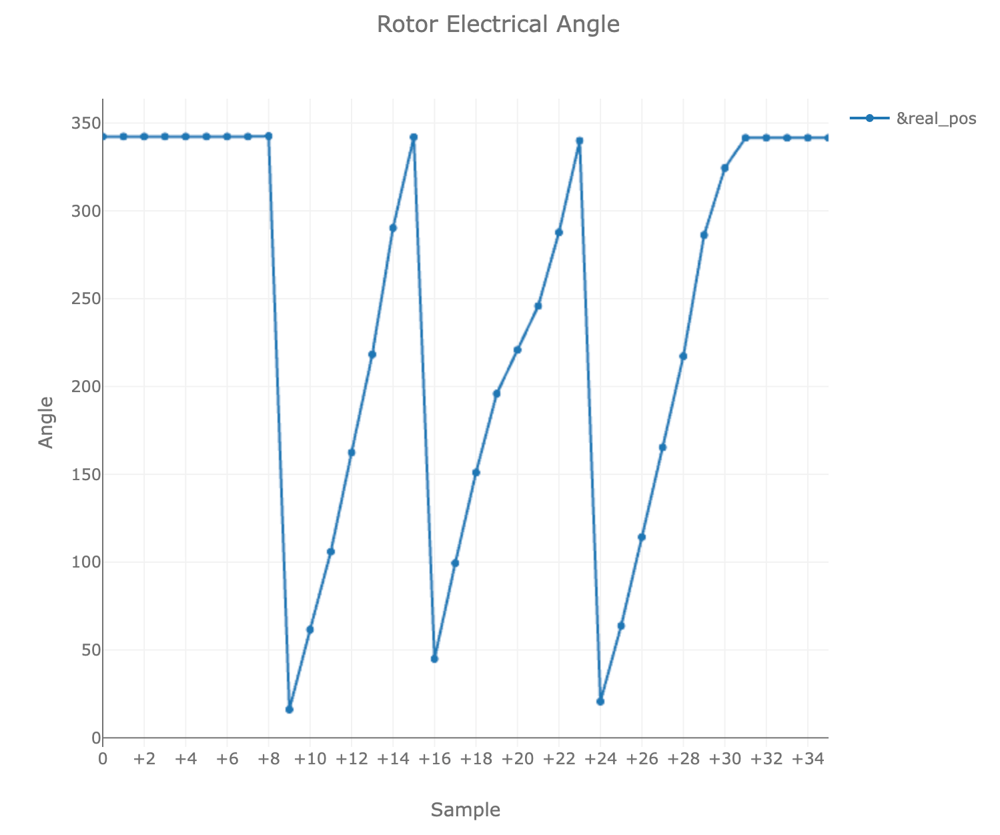
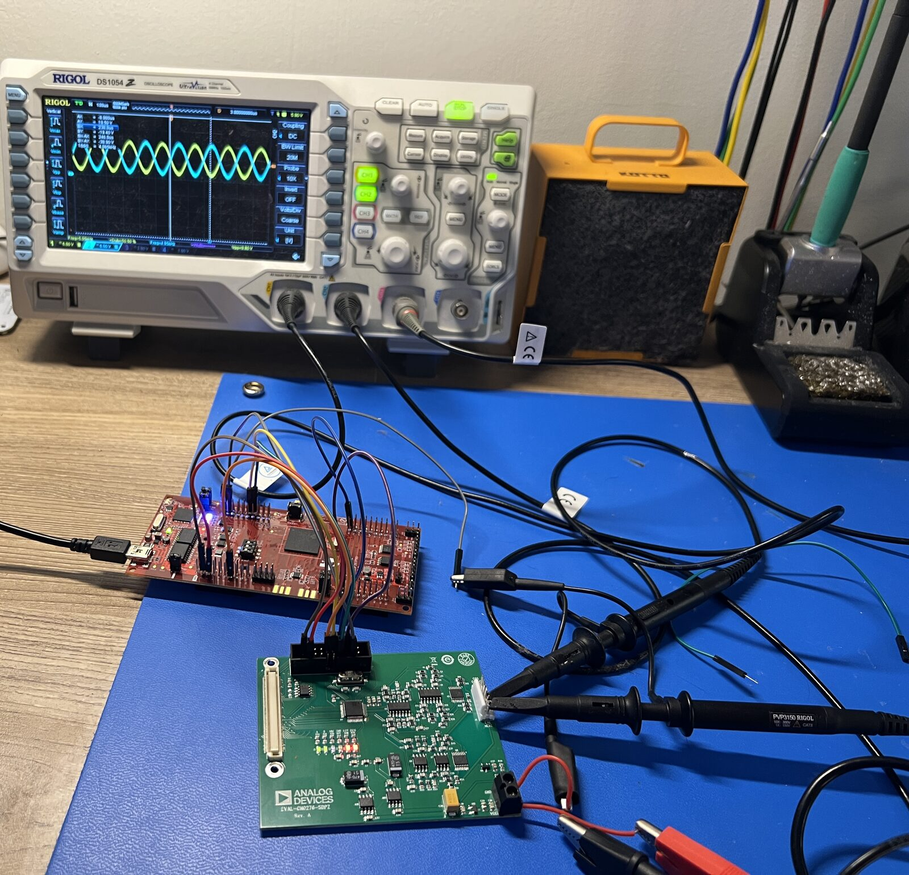

# AD2S1210 resolver driver on a TI C2000 (F28379D)

A register level SPI driver for the Analog Devices AD2S1210 resolver to digital converter, running on a TI LAUNCHXL-F28379D. I wrote it from the TI reference manual and the AD2S1210 datasheet, using the bitfield register headers and no driverlib in the peripheral code. It was tested on a real resolver on an induction motor, first turned by hand and then driven by an inverter, with the position read running inside the drive's PWM interrupt.

A resolver is a rotary transformer on the motor shaft. Its rotor winding is driven with a sine wave, and two stator windings pick that signal up with an amplitude that follows the sine and cosine of the shaft angle. The AD2S1210 generates the excitation, reads the two signals back, and turns them into a 16 bit angle that the C2000 reads over SPI.

This was my first C2000 project. My background before this was STM32.


Lab setup for the real resolver test. The LaunchPad is at the bottom left, the motor with the resolver is in the background, and the laptop shows the hand turn graph.

## Results



One mechanical revolution by hand gives 3 electrical cycles, as expected for 3 pole pairs. The fault register read 0x00.


Resolver angle over one mechanical revolution with the motor driven in V/f, speed changed mid run. At rest it reads 16223 counts = 89.1 degrees. This is plotted from the CCS debugger, so the samples are not evenly spaced in time (see lesson 18 in [docs/lessons.md](docs/lessons.md)).

### What was measured

| Test | Result |
|---|---|
| SPI clock | 1 MHz on the scope with `SPIBRR = 49` |
| Register write | 0x14 written to 0x91, excitation output changed to 5 kHz on the scope |
| Register read | 0x91 read back as 0x14 |
| Clean reset, no resolver | 0x91 = 0x28, 0x92 = 0x7E, fault = 0x70 |
| Real resolver, turned by hand | 3 electrical cycles per mechanical turn, fault register 0x00 |
| Number check | 660 counts = 3.63 degrees, matches the hand calculation |
| Motor driven in V/f | 3 electrical cycles per mechanical turn, 16223 counts = 89.1 degrees at rest |
| Repeatability | Same reading after a full mechanical revolution |
| Inside the PWM interrupt | Position read runs inside the ePWM interrupt of an induction motor drive on a Wolfspeed XM3 inverter |
| Standalone | Runs from flash with no debugger attached |

## System Integration


The C2000 is the SPI master. Two GPIO lines drive A0 and A1 to pick the AD2S1210's mode, and a third drives SAMPLE, whose falling edge latches the angle. The AD2S1210 handles the resolver side by itself once its excitation frequency is set.



Home bench setup, used to prove register access before the real resolver. The scope shows the excitation output at 5 kHz after the register write. The red LEDs are the LOT and DOS faults, lit because no resolver is connected.

## Communicating with the AD2S1210

All of the code is in [src/main.c](src/main.c). The snippets below are copied from it.

### SPI setup

SPI A runs as master at 1 MHz, polled, with no FIFO. `Device_init()` sets SYSCLK to 200 MHz and LSPCLK to 50 MHz, so `SPIBRR = 49` gives 50 MHz / 50 = 1 MHz, which I checked on the scope.

```c
void SPI_init(){

    SpiaRegs.SPICCR.bit.SPISWRESET = 0x0UL;     // hold in reset while configuring
    SpiaRegs.SPICTL.bit.MASTER_SLAVE = 0x1UL;
    SpiaRegs.SPICTL.bit.TALK = 0x1UL;           // master alone does not enable the output

    SpiaRegs.SPICCR.bit.CLKPOLARITY = 0x0UL;
    SpiaRegs.SPICTL.bit.CLK_PHASE = 0x0UL;

    SpiaRegs.SPIBRR.bit.SPI_BIT_RATE = 49; // 50 MHz / (49+1) = 1 MHz clock
    SpiaRegs.SPICCR.bit.SPICHAR = 0x7UL; //8 bit message size
    SpiaRegs.SPIPRI.bit.FREE = 1; //Allows SPI clock to run in debug
    SpiaRegs.SPICCR.bit.SPISWRESET = 0x1UL;     // release reset last

    //SpiaRegs.SPICCR.bit.SPILBK = 1;
}
```

- The SPI has to be held in reset (`SPISWRESET = 0`) while it is configured and released last.
- `TALK` has to be set or nothing comes out of the master.
- Clock idle low with no phase delay puts data out on the rising edge and reads it on the falling edge, which is what the AD2S1210 wants.
- In master mode the SPISTE pin frames every word by itself, so it is wired to the chip's WR/FSYNC.

### Two modes

| A0 A1 | Mode | SPI word | Used for |
|---|---|---|---|
| 1 1 | Configuration | 8 bit | Reading and writing registers |
| 0 0 | Normal | 16 bit | Reading the angle |

Each mode has a small function that sets the pins and the SPI word size to match.

```c
void AD2S_Config_mode(){

    //Sets A0,A1 to 11 for configuration mode
    GpioDataRegs.GPASET.all = 1UL<<19; //J1 PIN3 (GPIO19)
    GpioDataRegs.GPBSET.all = 0x1UL; //J1 PIN2 (GPIO32)
    SpiaRegs.SPICCR.bit.SPICHAR = 0x7UL;    // 8 bit words for register access

}
```

```c
void AD2S_Normal_mode(){

    //Sets A0,A1 to 00 for normal mode
    GpioDataRegs.GPACLEAR.all = 1UL<<19; //J1 PIN3 (GPIO19)
    GpioDataRegs.GPBCLEAR.all = 0x1UL; //J1 PIN2 (GPIO32)

    SpiaRegs.SPICCR.bit.SPISWRESET = 0;     // SPI into reset to change the word size
    SpiaRegs.SPICCR.bit.SPICHAR = 0xF;      // 16 bit words for the position
    SpiaRegs.SPICCR.bit.SPISWRESET = 1;     // and back out of reset

}
```

### Configuration mode: register access

In configuration mode every transfer is one byte. A byte with the top bit set is an address and a byte with the top bit clear is data. To write a register, send the address and then the data. The C2000 transmit buffer is 16 bits wide and an 8 bit word has to sit in the top half, so every byte is shifted left by 8 before it is sent.

Reading is the odd part. The chip answers one transfer late, so the reply to an address comes back during the next transfer. The read sends the address twice and keeps the second reply. SAMPLE is pulsed first so the fault data is fresh.

```c
Uint16 SPI_Rx_polling(Uint16 data){

    //Pulse the sample pin ON/OFF (falling edge latches fault data)
    GpioDataRegs.GPBSET.bit.GPIO40 = 0x1UL;
    DEVICE_DELAY_US(1);
    GpioDataRegs.GPBCLEAR.bit.GPIO40 = 0x1UL;

    SpiaRegs.SPITXBUF = (data)<<8;
    while(SPI_FLAG==0){}
    SPI_RX = SpiaRegs.SPIRXBUF;

    //Send the address again as dummy byte to shift in the AD2S' answer
    SpiaRegs.SPITXBUF = (data)<<8;
    while(SPI_FLAG==0){}
    SPI_RX = SpiaRegs.SPIRXBUF;

    return SPI_RX;
}
```

| Address | Register | Notes |
|---|---|---|
| 0x91 | Excitation frequency | Value x 250 Hz with the 8.192 MHz crystal. 0x28 = 10 kHz, 0x14 = 5 kHz |
| 0x92 | Control | Default 0x7E |
| 0xFF | Fault | 0x00 means no faults |

The code before the `while` loop in `main()` is the bench verification. It reads 0x91, writes 0x28 to it (10 kHz, what I ran the resolver at), then reads the fault and control registers so they can be checked in the watch window. On the bench I wrote 0x14 instead and saw the excitation change to 5 kHz on the scope.

### Normal mode: position read

In normal mode the read is one SAMPLE pulse and one 16 bit transfer. The data sent out is a dummy word that only exists to make the 16 clocks.

```c
Uint16 SPI_Rx_normal(){

    Uint16 data = 0x5555;   // dummy word, only sent to generate the 16 clocks

    //Pulse the sample pin ON/OFF (falling edge latches the position)
    GpioDataRegs.GPBSET.bit.GPIO40 = 0x1UL;
    DEVICE_DELAY_US(1);
    GpioDataRegs.GPBCLEAR.bit.GPIO40 = 0x1UL;

    //Clock out 16 bits to shift in the angle (16 bit word, no shift needed)
    SpiaRegs.SPITXBUF = (data);
    while(SPI_FLAG==0){}
    SPI_RX = SpiaRegs.SPIRXBUF;

    return SPI_RX;
}
```

```c
    while (1){

        position = SPI_Rx_normal();                     // 0 to 65535 counts
        real_pos = (position/65536.0f)*360.0f;          // electrical degrees, 65536 counts = 360

    }
```

`SPI_FLAG` is a macro for `SpiaRegs.SPISTS.bit.INT_FLAG`, so the register bit is read fresh on every pass of the wait loop. 65536 counts is one electrical revolution. A reading of 660 counts gave 3.63 degrees, which matched the number worked out by hand.

In the motor drive the same read ran inside the ePWM interrupt. SAMPLE goes high near the start of the interrupt, some control code runs, then SAMPLE goes low for 3 µs (measured) and the 16 bit position is read. The drive code is not part of this repo.

## Lessons learned

The full list of 18 is in [docs/lessons.md](docs/lessons.md). These are the four that cost the most time.

**No clock on the SPICLK pin.** The SPI registers all looked right but the scope showed nothing on SPICLK. One GMUX line for GPIO60 was missing. Every SPI pin needs both its GMUX and MUX set. Check the pin with a scope before debugging the peripheral.

**Fault register showed an old value.** Fault data only updates on a falling edge of SAMPLE. Pulsing SAMPLE before the read fixed it.

**Registers kept old or scrambled values after a power cycle.** I first blamed noise on floating lines, reset timing and back powering. Measuring the board's 3.3 V rail showed it only fell to about 2.2 V at power off and then decayed slowly. A quick power cycle was really a brownout and the board's RC reset never fired. Waiting until the rail reads about 10 mV before powering on gives a clean reset.

**"Unable to step, AET resources" in the flash build.** Flash builds only get about two hardware breakpoints. Remove breakpoints or debug from RAM.

## Hardware

| Item | Detail |
|---|---|
| MCU board | TI LAUNCHXL-F28379D (TMS320F28379D, XDS100v2 debug probe on the board) |
| Converter board | Analog Devices EVAL-CN0276-SDPZ (AD2S1210, 8.192 MHz crystal) |
| Board supply | 12 V bench supply, 100 mA current limit. The board has its own 3.3 V regulator |
| Scope | Rigol DS1054Z |
| Resolver | 3 pole pairs, on an induction motor, 10 kHz excitation |
| Inverter (V/f test) | Wolfspeed XM3 |
| Tools | Code Composer Studio 21.0.1, C2000Ware 26.02.00.00 |

## Wiring

| C2000 pin | Function | CN0276 J2 |
|---|---|---|
| GPIO58 | SPISIMOA | SDI (pin 12) |
| GPIO59 | SPISOMIA | SDO (pin 13) |
| GPIO60 | SPICLKA | SCLK (pin 10) |
| GPIO61 | SPISTEA | WR/FSYNC (pin 17) |
| GPIO19 (J1 pin 3) | GPIO output | A0 or A1 |
| GPIO32 (J1 pin 2) | GPIO output | A0 or A1 |
| GPIO40 (J5 pin 50) | GPIO output | SAMPLE (pin 15) |
| GND | | GND |

SOE (J2 pin 16) is tied to GND to select the serial interface. RES0 and RES1 were left unconnected and the board gives 16 bit output that way. The full J2 pinout and notes are in [docs/wiring.md](docs/wiring.md).

## References

- [AD2S1210 product page and datasheet](https://www.analog.com/en/products/ad2s1210.html) (Analog Devices, Rev. B used)
- [CN0276 circuit note and EVAL-CN0276-SDPZ design files](https://www.analog.com/en/resources/reference-designs/circuits-from-the-lab/cn0276.html) (Analog Devices)
- [TMS320F2837xD Technical Reference Manual, SPRUHM8](https://www.ti.com/lit/pdf/spruhm8) (GPIO and SPI chapters)
- [TMS320F2837xD datasheet, SPRS880](https://www.ti.com/lit/pdf/sprs880) (pin mux table)
- [LAUNCHXL-F28379D user guide, SPRUI77](https://www.ti.com/lit/pdf/sprui77) (connector pinout)

## License

MIT. See [LICENSE](LICENSE).
