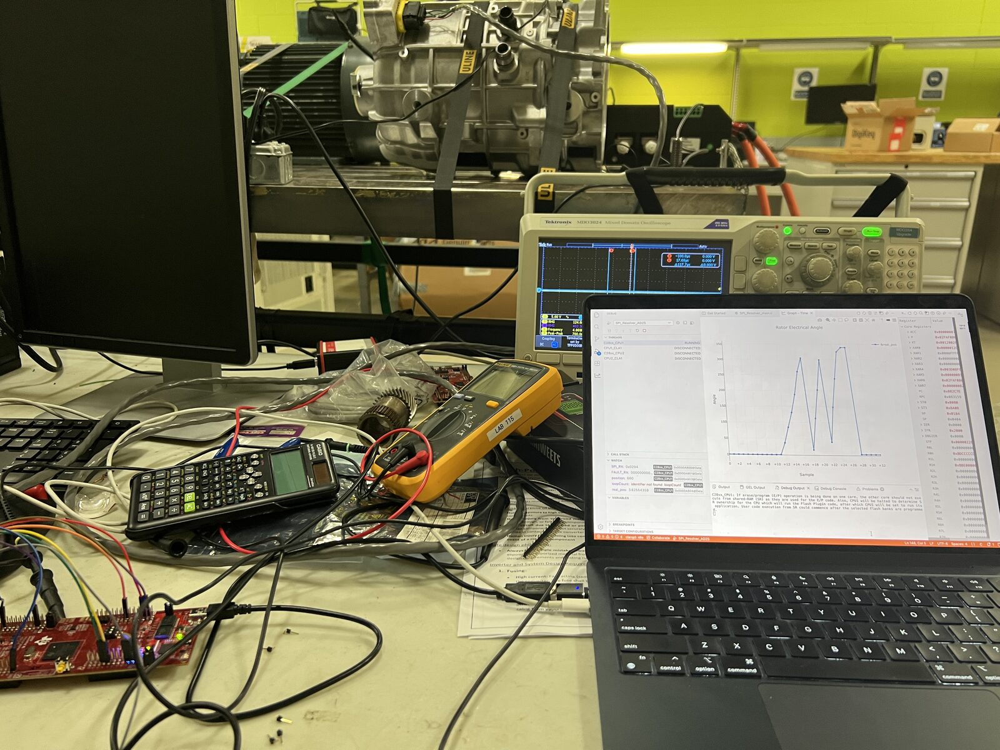
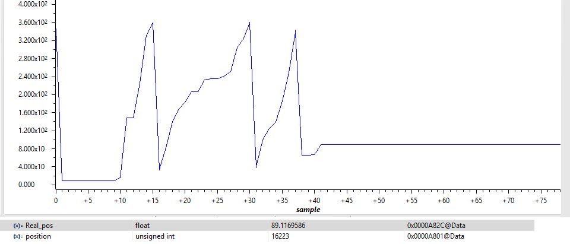
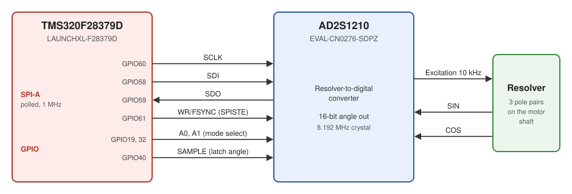

# AD2S1210 resolver driver on a TI C2000 (F28379D)

A register-level SPI driver for the Analog Devices AD2S1210 resolver-to-digital converter, running on a TI LAUNCHXL-F28379D. I wrote it from the TI reference manual and the AD2S1210 datasheet, with bitfield register access and no driverlib in the peripheral code. It was tested on a real resolver on an induction motor, first turned by hand and then driven by an inverter, with the position read running inside the drive's PWM interrupt.

A resolver is a rotary transformer on the motor shaft. Its rotor winding is driven with a sine wave, and two stator windings pick that signal up with an amplitude that follows the sine and cosine of the shaft angle. The AD2S1210 generates the excitation, reads the two signals back, and turns them into a 16-bit angle that the C2000 reads over SPI.

This was my first C2000 project. My background before this was STM32.



Lab setup for the real resolver test. The LaunchPad is at the bottom left, the motor with the resolver is in the background, and the laptop shows the hand-turn graph.

## Results


One mechanical revolution by hand gives 3 electrical cycles, as expected for 3 pole pairs. The fault register read 0x00.



Resolver angle over one mechanical revolution with the motor driven in V/f, speed changed mid run. At rest it reads 16223 counts = 89.1 degrees. This is plotted from the CCS debugger, so the samples are not evenly spaced in time (see lesson 18 in [docs/lessons.md](docs/lessons.md)).

### What was measured

| Test | Result |
|---|---|
| SPI clock | 1 MHz on the scope with `SPIBRR = 49` |
| Register write | 0x14 written to 0x91, excitation output changed to 5 kHz on the scope |
| Register read | 0x91 read back as 0x14 |
| Clean reset, no resolver | 0x91 = 0x28, 0x92 = 0x7E, fault = 0x70 |
| Real resolver, turned by hand | 3 electrical cycles per mechanical turn, fault register 0x00 |
| Number check | 660 counts = 3.63 degrees, matches the hand calculation |
| Motor driven in V/f | 3 electrical cycles per mechanical turn, 16223 counts = 89.1 degrees at rest |
| Repeatability | Same reading after a full mechanical revolution |
| Inside the PWM interrupt | Position read runs inside the ePWM interrupt of an induction motor drive on a Wolfspeed XM3 inverter |
| Standalone | Runs from flash with no debugger attached |

## How it fits together



The C2000 is the SPI master. A0 and A1 pick the AD2S1210's mode. Both high is configuration mode, where 8-bit transfers read and write registers. Both low is normal mode, where a 16-bit transfer returns the angle. A falling edge on SAMPLE latches the angle before each read. The AD2S1210 handles the resolver side by itself once its excitation frequency is set.

## The position read

This is the part that runs in the loop. Pulse SAMPLE, clock out 16 bits, and the reply is the angle.

```c
Uint16 SPI_Rx_normal(){

    Uint16 data = 0x5555;   // dummy word, only sent to generate the 16 clocks

    //Pulse the sample pin ON/OFF (falling edge latches the position)
    GpioDataRegs.GPBSET.bit.GPIO40 = 0x1UL;
    DEVICE_DELAY_US(1);
    GpioDataRegs.GPBCLEAR.bit.GPIO40 = 0x1UL;

    //Clock out 16 bits to shift in the angle (16-bit word, no shift needed)
    SpiaRegs.SPITXBUF = (data);
    while(SPI_FLAG==0){}
    SPI_RX = SpiaRegs.SPIRXBUF;

    return SPI_RX;
}
```

```c
    while (1){

        position = SPI_Rx_normal();                     // 0 to 65535 counts
        real_pos = (position/65536.0f)*360.0f;          // electrical degrees, 65536 counts = 360

    }
```

`SPI_FLAG` is a macro for `SpiaRegs.SPISTS.bit.INT_FLAG`, so the register bit is read fresh on every pass of the wait loop. The full file is [src/main.c](src/main.c).

In the motor drive the same read ran inside the ePWM interrupt. SAMPLE goes high near the start of the interrupt, some control code runs, then SAMPLE goes low for 3 µs (measured) and the 16-bit position is read. The drive code is not part of this repo.

## Lessons learned

The full list of 18 is in [docs/lessons.md](docs/lessons.md). These are the four that cost the most time.

**No clock on the SPICLK pin.** The SPI registers all looked right but the scope showed nothing on SPICLK. One GMUX line for GPIO60 was missing. Every SPI pin needs both its GMUX and MUX set. Check the pin with a scope before debugging the peripheral.

**Fault register showed an old value.** Fault data only updates on a falling edge of SAMPLE. Pulsing SAMPLE before the read fixed it.

**Registers kept old or scrambled values after a power cycle.** I first blamed noise on floating lines, reset timing and back-powering. Measuring the board's 3.3 V rail showed it only fell to about 2.2 V at power-off and then decayed slowly. A quick power cycle was really a brown-out and the board's RC reset never fired. Waiting until the rail reads about 10 mV before powering on gives a clean reset.

**"Unable to step, AET resources" in the flash build.** Flash builds only get about two hardware breakpoints. Remove breakpoints or debug from RAM.

## Not tested yet

- Angle accuracy within a revolution against a reference. Repeatability is shown. Absolute accuracy is not.
- High speed behaviour and the velocity readout.
- Fault detection with a resolver wire pulled.
- The threshold registers (0x88 to 0x8E) are left at their defaults.
- A startup check sequence (write, read back, soft reset, check fault bit D0). The current code reads the registers but does not act on the values.
- Pull resistors on the mode and framing lines. They were never fitted and no problems were seen without them. See lesson 12.

Seen once and not explained:
- The board once came up at 8 kHz excitation after a long power-off.
- A register read once seemed to change the excitation frequency before any write.

---

## Hardware

| Item | Detail |
|---|---|
| MCU board | TI LAUNCHXL-F28379D (TMS320F28379D, on-board XDS100v2 debug probe) |
| Converter board | Analog Devices EVAL-CN0276-SDPZ (AD2S1210, 8.192 MHz crystal) |
| Board supply | 12 V bench supply, 100 mA current limit. The board has its own 3.3 V regulator |
| Scope | Rigol DS1054Z |
| Resolver | 3 pole pairs, on an induction motor, 10 kHz excitation |
| Inverter (V/f test) | Wolfspeed XM3 |


Home bench setup. The scope shows the excitation output at 5 kHz after the register write. The red LEDs are the LOT and DOS faults, lit because no resolver is connected.

## Wiring

| C2000 pin | Function | CN0276 J2 |
|---|---|---|
| GPIO58 | SPISIMOA | SDI (pin 12) |
| GPIO59 | SPISOMIA | SDO (pin 13) |
| GPIO60 | SPICLKA | SCLK (pin 10) |
| GPIO61 | SPISTEA | WR/FSYNC (pin 17) |
| GPIO19 (J1 pin 3) | GPIO output | A0 or A1 |
| GPIO32 (J1 pin 2) | GPIO output | A0 or A1 |
| GPIO40 (J5 pin 50) | GPIO output | SAMPLE (pin 15) |
| GND | | GND |

SOE (J2 pin 16) is tied to GND to select the serial interface. RES0 and RES1 were left unconnected and the board gives 16-bit output that way. The full J2 pinout and notes are in [docs/wiring.md](docs/wiring.md).

## SPI settings

| Setting | Value | Register field |
|---|---|---|
| Role | Master, transmit enabled | `SPICTL.MASTER_SLAVE = 1`, `SPICTL.TALK = 1` |
| Clock polarity | Idle low | `SPICCR.CLKPOLARITY = 0` |
| Clock phase | No delay | `SPICTL.CLK_PHASE = 0` |
| Edges | Data out on rising edge, read on falling edge | matches the AD2S1210 |
| Bit rate | 1 MHz, measured on the scope | `SPIBRR = 49` |
| Word length | 8 bits for registers, 16 bits for position | `SPICCR.SPICHAR = 7` or `15` |
| Debug behaviour | Keeps running at a breakpoint | `SPIPRI.FREE = 1` |
| FIFO | Not used | |
| Transfer | Polled. Write `SPITXBUF`, wait for `SPISTS.INT_FLAG`, read `SPIRXBUF` | |

Clocks: `Device_init()` sets SYSCLK to 200 MHz. LSPCLK is SYSCLK / 4 = 50 MHz. SPI clock = LSPCLK / (SPIBRR + 1) = 1 MHz.

The only TI helper calls in the code are `Device_init()` (clock, PLL, watchdog, peripheral clocks) and `DEVICE_DELAY_US()`. Both come from TI's `device.c` and `device.h`.

Things that mattered:
- Configure with `SPISWRESET = 0` and set it to 1 last.
- 8-bit words must be left-justified in the 16-bit `SPITXBUF`, so a byte is shifted left by 8. Received data comes back right-justified.
- In master mode the SPISTE pin frames each word by itself, so it works as the chip's WR/FSYNC.

## Register access (bench verification)

The code before the `while` loop in [src/main.c](src/main.c) is the bench verification. I used it at home to prove register access before connecting a real resolver. It reads the excitation frequency register, writes it, then reads the fault and control registers.

- 8-bit transfers. A byte with the top bit set is an address. A byte with the top bit clear is data.
- Write: send the address, then the data.
- Read: send the address, then send it again and keep the second reply. The first reply belongs to whatever was addressed before.
- SAMPLE is pulsed before each read so the fault data is fresh.

| Address | Register | Notes |
|---|---|---|
| 0x91 | Excitation frequency | Frequency = value x 250 Hz with the 8.192 MHz crystal. 0x28 = 10 kHz, 0x14 = 5 kHz |
| 0x92 | Control | Default 0x7E |
| 0xFF | Fault | 0x00 means no faults |

The bench test wrote 0x14 (5 kHz). The code in the repo writes 0x28 (10 kHz), which is what I used with the real resolver.

## Build and flash

Tools: Code Composer Studio 21.0.1 and C2000Ware 26.02.00.00.

1. In CCS, create a new project from the "Driverlib + Bit-Field Empty Example CCS Project" template for the TMS320F28379D.
2. Replace the template's `main.c` with [src/main.c](src/main.c).
3. Check the predefined symbols. Both build configs need `CPU1` and `_LAUNCHXL_F28379D`. The flash config also needs `_FLASH`.
4. Check that only one device linker `.cmd` is active per config, plus the headers `.cmd`.
5. Build `CPU1_RAM` to debug, or `CPU1_FLASH` to run standalone. Connect with the XDS100v2 on the LaunchPad.
6. Watch `position` and `real_pos` in the Expressions window. Graph `real_pos` to see the angle.

## References

- [AD2S1210 product page and datasheet](https://www.analog.com/en/products/ad2s1210.html) (Analog Devices, Rev. B used)
- [CN0276 circuit note and EVAL-CN0276-SDPZ design files](https://www.analog.com/en/resources/reference-designs/circuits-from-the-lab/cn0276.html) (Analog Devices)
- [TMS320F2837xD Technical Reference Manual, SPRUHM8](https://www.ti.com/lit/pdf/spruhm8) (GPIO and SPI chapters)
- [TMS320F2837xD datasheet, SPRS880](https://www.ti.com/lit/pdf/sprs880) (pin mux table)
- [LAUNCHXL-F28379D user guide, SPRUI77](https://www.ti.com/lit/pdf/sprui77) (connector pinout)

## License

MIT. See [LICENSE](LICENSE).
